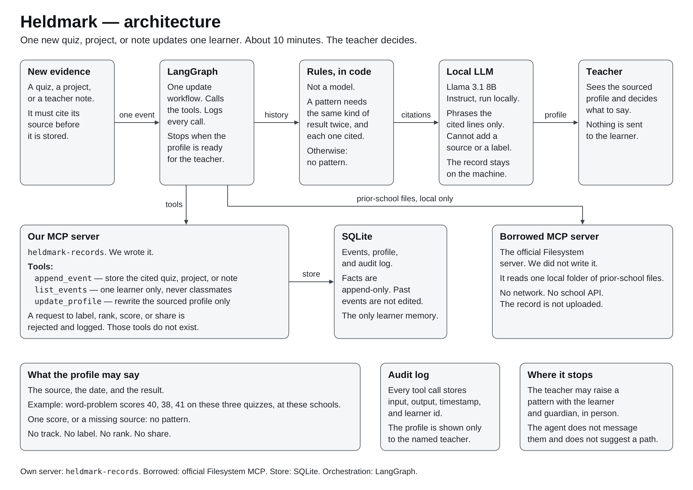

# Heldmark

Follows one learner across school moves. Cited quizzes, projects, and notes update a sourced profile. A pattern is stated only when the same result has held, and the teacher decides. No label, rank, or path.

## Problem statement

In a Ghanaian public basic school, a learner's record stops at the school gate. Marks and teacher notes stay in that school's mark book. The next school is not required to receive them.

A Grade 2 learner who changes school several times, because the family's housing keeps shifting, meets each new teacher as a new pupil. One term can show a score. It cannot show what has held. What has held is scattered across mark books whose teachers will never meet. Without a record that follows the child, a pattern surfaces years later, often at a national exam, when the early years in which a teacher could have talked with the family are gone.

## Solution overview

Heldmark keeps one learner's quizzes, projects, and teacher notes as cited events, including after a move. When new evidence arrives, an agent updates that learner's profile. Ordinary code states a pattern only when the same kind of result appears at least twice, and every line names the quiz, project, or note it came from. One score, or a missing source, produces no pattern.

The profile does not label, score, or rank the child, and it does not suggest a subject path. A named teacher reads it and decides what to raise with the learner and their guardian. The agent does not message them.

## Target users

- The receiving teacher, who otherwise starts a new term with no history.
- The learner whose record currently resets at each school.
- The guardian, who hears a sourced pattern from the teacher, not from the software.

It is not a school management system, a class ranking tool, or a career guide.

## Architecture

One new quiz, project, or note starts a single LangGraph workflow.

1. The event is stored with its source.
2. The agent reads that learner's history only.
3. Rules in code decide whether a pattern exists.
4. A local open-weights model phrases the cited lines and cannot add a source or a label.
5. The sourced profile is shown to the named teacher. The run stops.

Prior-school files are read from a local folder through a borrowed Filesystem MCP server. Learner memory is SQLite. Facts are append-only.

The one-page account is [ARCHITECTURE.md](ARCHITECTURE.md).



The same diagram is available as a PDF in [docs/architecture.pdf](docs/architecture.pdf).

## Setup/installation instructions

Requirements: Python 3.11+ and Node.js 18+ (for the borrowed Filesystem MCP server). [Ollama](https://ollama.com) with the Llama 3.1 8B Instruct model is needed only for the phrasing step.

```bash
git clone https://github.com/Heights001/Heldmark.Agent.git && cd Heldmark.Agent && python3.11 -m venv .venv && source .venv/bin/activate && pip install -e ".[dev]" && python -m heldmark.demo
```

The tests are `python -m pytest`.

`python -m heldmark.demo` loads the five-school fixture and prints the sourced profile. The demo and the tests do not need Ollama. No learner data leaves the machine.

To run the full graph:

```bash
npm install
ollama pull llama3.1:8b
python -m heldmark.run
```

`python -m heldmark.run` reads the intake folder through the Filesystem MCP server, stores each valid cited event through `heldmark-records`, rewrites the profile from the rules, and then uses the local model when it is available. If Ollama is not running, it still prints the rule profile and says the phrasing was skipped. If a model sentence adds a label, a rank, a path, or a source that was not given to it, that sentence is discarded and the rule text is kept.

## Usage instructions

Add one cited event, then refresh the profile:

```bash
python -m heldmark add-event --learner L1 --source "Class 2 word problem, 12 March, School 4" --kind word_problem --score 40 --date 2026-03-12
python -m heldmark update-profile --learner L1
```

The printed profile states a pattern only when the same kind of result appears at least twice. Each line cites its source. A request to label, rank, score, or share the learner is rejected.

## Technology stack

- Python
- LangGraph
- Official MCP Python SDK
- SQLite
- Ollama, running Llama 3.1 8B Instruct locally

No vector database. No school-information API. No closed no-code builder.

## Agent architecture

LangGraph runs one update, aimed at about ten minutes. The model does not choose the steps and does not decide the pattern. The rule is fixed: the same kind of result, at least twice, each one cited. The model receives only the lines the rule has allowed. The graph ends when the profile is ready for the named teacher.

## MCP implementation

The agent holds one MCP client and calls two servers.

- `heldmark-records` is written for this project. It is the only place learner facts are stored or changed.
- The official Filesystem MCP server is borrowed. It only reads a local intake folder of prior-school files. Sandboxed file access is already maintained there, so the learner server is not also a file browser. It has no network access.

Every call is logged with its input, output, timestamp, and learner id.

## MCP tools/servers

Server `heldmark-records`:

| Tool | What it does |
|---|---|
| `append_event` | Stores one cited quiz, project, or note. |
| `list_events` | Returns one learner, in order. It cannot see classmates. |
| `update_profile` | Rewrites the sourced profile and nothing else. |

There is no tool to label, score, rank, recommend a path, or share. A request for one is rejected and logged. Resource: `learner://{id}/events`.

Borrowed server: official Filesystem MCP, local intake folder only.

## Human-in-the-loop workflow

The agent stops at the named teacher. She sees the sourced profile and decides whether to raise a pattern with the learner and guardian, in person. Nothing is sent to them. The profile is not scored and not ranked against a class. The audit log records who the profile was shown to.

## Limitations

- A pattern cannot be claimed from a single score, a combined subject mark, or a note with no source.
- Prior schools do not push data in. Someone must place their files in the local intake folder.
- The local model only phrases lines the rules already allowed. It can still write a clumsy sentence. The teacher can reject it.
- This does not choose a subject, a programme, or a career.
- The Grade 2 moves are an anonymised scenario. The repo contains no real child's name, address, or school names.

## Future improvements

- A one-page paper form a teacher can fill in under five minutes, then drop in the intake folder.
- More task kinds than calculation and word problem, still cited the same way.
- A signed export the next school can import, so the folder is not carried by hand.
- The one failure left open in `EVALS.md`, and the next change proposed for it.
